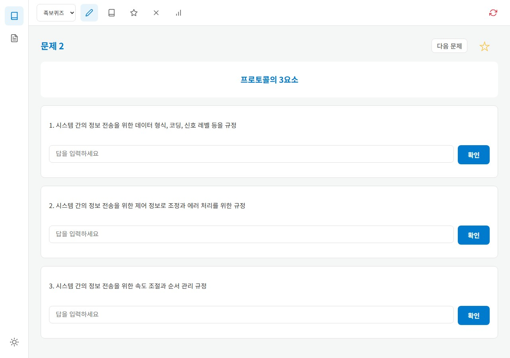
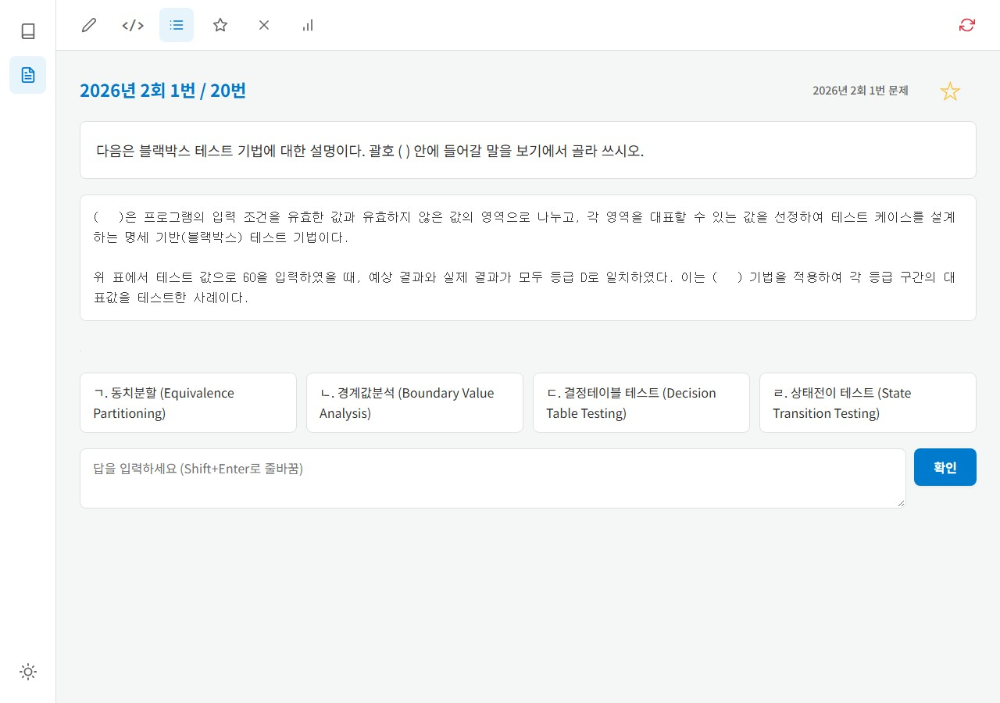
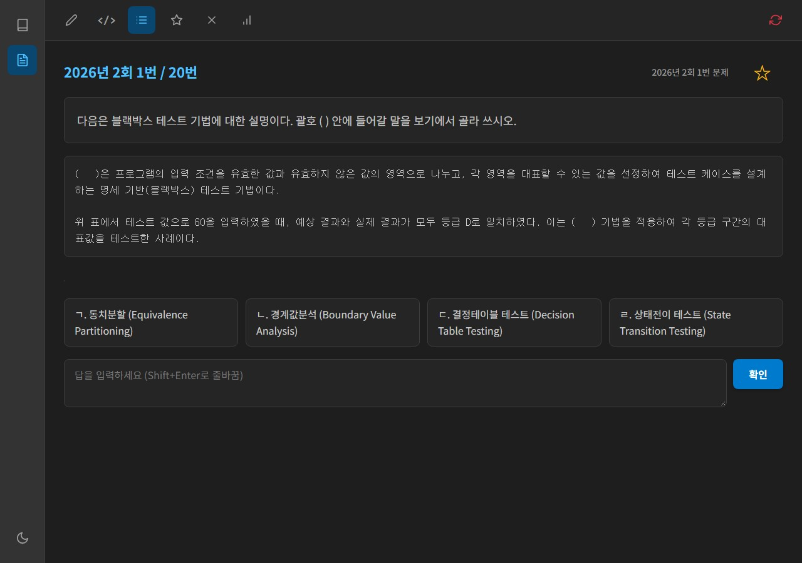

# EIPractice

정보처리기사 실기 대비용 퀴즈 애플리케이션입니다.

## 자료 출처

기출문제의 경우 복원문제를 활용했습니다.

- [[2026년 대비] 핵심 키워드만 암기하면 쉽게 기억되는 키워드 찾기 130문제](https://www.sinagong.co.kr/pds/001001002/past-exams)
- [정보처리기사 실기 족보 1탄](https://chobopark.tistory.com/193)
- [정보처리기사 실기 족보 2탄](https://chobopark.tistory.com/197)
- [정보처리기사 실기 기출문제 2020년 1회](https://chobopark.tistory.com/196)
- [정보처리기사 실기 기출문제 2020년 2회](https://chobopark.tistory.com/195)
- [정보처리기사 실기 기출문제 2020년 3회](https://chobopark.tistory.com/194)
- [정보처리기사 실기 기출문제 2020년 4회](https://chobopark.tistory.com/192)
- [정보처리기사 실기 기출문제 2021년 1회](https://chobopark.tistory.com/191)
- [정보처리기사 실기 기출문제 2021년 2회](https://sssinga.tistory.com/entry/%EC%A0%95%EB%B3%B4%EC%B2%98%EB%A6%AC%EA%B8%B0%EC%82%AC-%EC%8B%A4%EA%B8%B0-2021%EB%85%84-2%ED%9A%8C-%EA%B8%B0%EC%B6%9C%EB%AC%B8%EC%A0%9C-%EB%B3%B5%EC%9B%90-%EB%B0%8F-%EB%8B%B5%ED%95%B4%EC%84%A4)
- [정보처리기사 실기 기출문제 2021년 3회](https://sssinga.tistory.com/entry/%EC%A0%95%EB%B3%B4%EC%B2%98%EB%A6%AC%EA%B8%B0%EC%82%AC-%EC%8B%A4%EA%B8%B0-2021%EB%85%84-3%ED%9A%8C-%EA%B8%B0%EC%B6%9C%EB%AC%B8%EC%A0%9C-%EB%B3%B5%EC%9B%90-%EB%B0%8F-%EB%8B%B5%ED%95%B4%EC%84%A4)
- [정보처리기사 실기 기출문제 2022년 1회](https://chobopark.tistory.com/271)
- [정보처리기사 실기 기출문제 2022년 2회](https://chobopark.tistory.com/423)
- [정보처리기사 실기 기출문제 2022년 3회](https://chobopark.tistory.com/424)
- [정보처리기사 실기 기출문제 2023년 1회](https://chobopark.tistory.com/372)
- [정보처리기사 실기 기출문제 2023년 2회](https://chobopark.tistory.com/420)
- [정보처리기사 실기 기출문제 2023년 3회](https://chobopark.tistory.com/453)
- [정보처리기사 실기 기출문제 2024년 1회](https://chobopark.tistory.com/476)
- [정보처리기사 실기 기출문제 2024년 2회](https://chobopark.tistory.com/483)
- [정보처리기사 실기 기출문제 2024년 3회](https://chobopark.tistory.com/495)
- [정보처리기사 실기 기출문제 2025년 1회](https://chobopark.tistory.com/540)
- [정보처리기사 실기 기출문제 2025년 2회](https://chobopark.tistory.com/554)
- [정보처리기사 실기 기출문제 2025년 3회](https://chobopark.tistory.com/558)
- [정보처리기사 실기 기출문제 2026년 1회](https://chobopark.tistory.com/561)
- [정보처리기사 실기 기출문제 2026년 2회](https://chobopark.tistory.com/562)

## 스크린샷

| 족보퀴즈 | 기출문제 | 다크모드 |
|:---:|:---:|:---:|
|  |  |  |

## 기술 스택

[](https://vuejs.org/)
[](https://vitejs.dev/)
[](https://developer.mozilla.org/ko/docs/Web/JavaScript)

## 실행 방법

프로젝트 루트의 `.env`에 Groq API 키를 설정합니다.

```dotenv
GROQ_API_KEY=발급받은_API_키
```

개발용 서버는 다음과 같이 실행합니다.

```bash
npm install
npm run dev
```

배포용 서버는 다음과 같이 실행합니다.

```bash
npm run build
npm start
```

기본 주소는 `http://127.0.0.1:3000`이며 `HOST`와 `PORT` 환경변수로 변경할 수 있습니다. 정적 파일만 호스팅할 경우 API를 실행하는 Node 서버로 연결해야 합니다.
